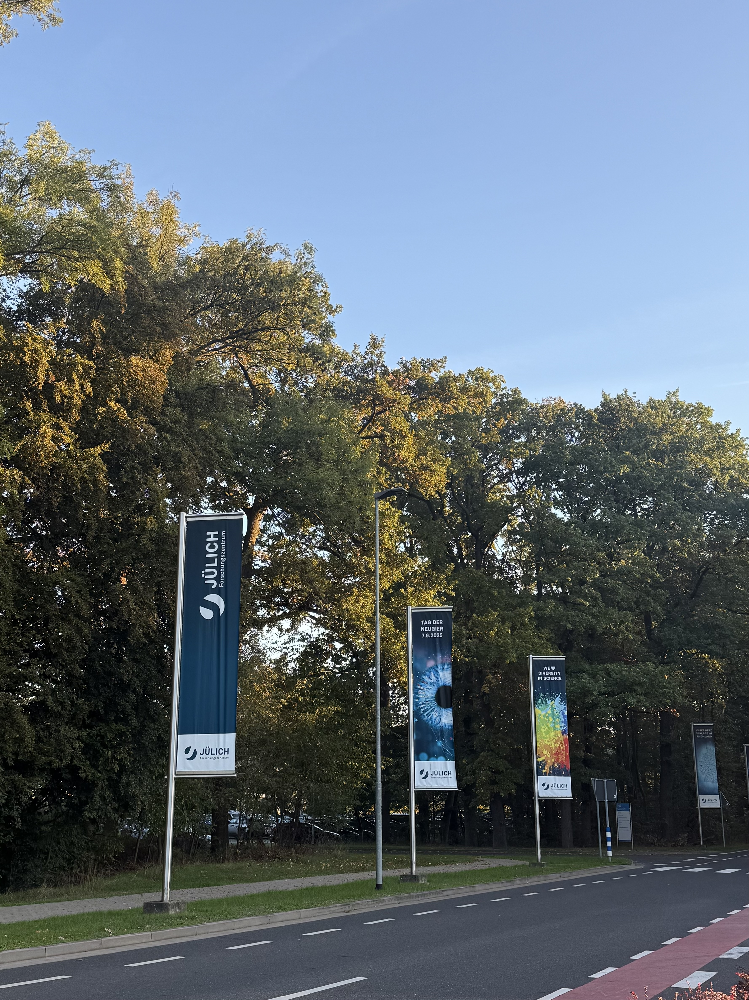
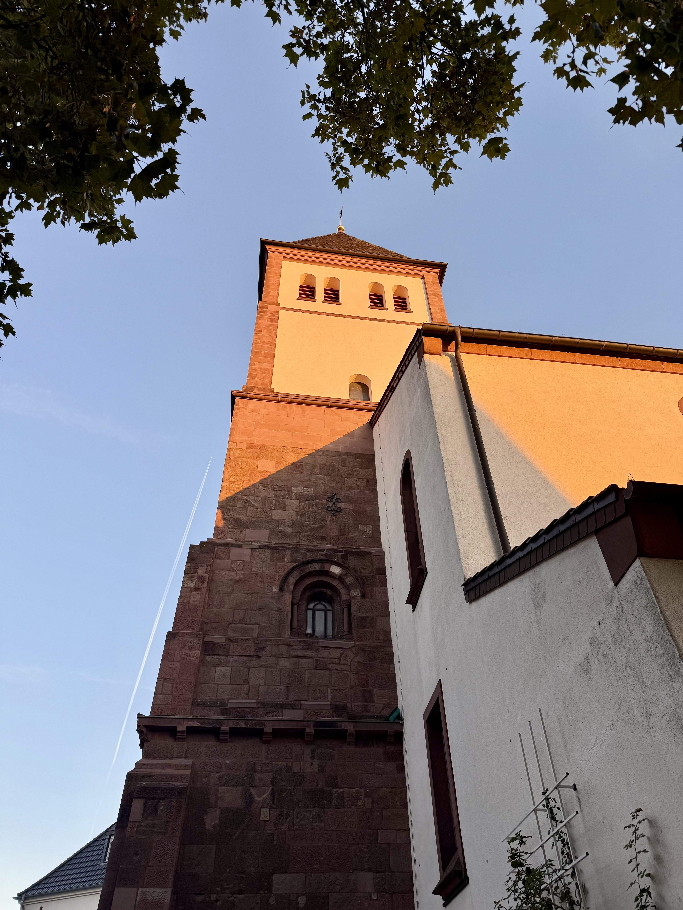

  
  

 

**I recently had the pleasure of visiting [Forschungszentrum Jülich](https://www.fz-juelich.de/en) in Germany to exchange knowledge with the team at the [Jülich Supercomputing Centre (JSC)](https://www.fz-juelich.de/en/institutes/jsc). Let me tell you a bit about my visit, what I learned and how you can have a similar experience too!**

## A little bit of background: 

JSC is home to [JUPITER](https://www.fz-juelich.de/en/jsc/jupiter), Europe’s first exascale supercomputer, as well as several other supercomputing and quantum computing services. It is also home to the JuWinHPC [Women in High Performance Computing (WHPC)](https://womeninhpc.org/) Chapter and the [POP Center of Excellence](https://pop-coe.eu/), which focuses on performance optimisation and productivity. 

I'm an Architect working at [EPCC](https://www.epcc.ed.ac.uk/), the UK’s first national supercomputing centre and home to the UK’s national supercomputer. I've worked at EPCC since 2020, learning through many different research projects and activities over the last 6 years. One of my roles for my entire EPCC career has been working as a Research Software Engineer (RSE) in the Computational Science and Engineering (CSE) support team for ARCHER2. This involves supporting the service users, implementing service improvements and delivering training. As well as this, I’m currently a co-I on the CAKE project (hopefully you've heard of us, as you've found yourself on our website!) where I lead our Placements & Visits flexible fund and an EDI working group. I’m also currently Acting Vice Chair of WHPC.

## Why JSC? 

I was visiting JSC with a specific goal in mind: to explore the idea of rerunning training delivered by an all-female team of instructors. 

The idea is to deliver training that is identical in content and format to the original, but with an entirely female team of instructors and helpers. This approach aims to create an environment where participants may feel more comfortable signing up, asking questions and getting involved. It's not about changing the training itself, but about exploring whether changing the team delivering it can make a difference to the participant experience.

This is something that has been explored in different settings, including by the POP team in [2021](https://pop-coe.eu/blog/diversifying-the-hpc-community-boosting-the-uptake-of-advanced-hpc-training-by-women-and) and again in [2022](https://pop-coe.eu/blog/diversifying-the-hpc-community-2nd-edition-of-the-hpc-training-by-women-and-underrepresented). Both events had some really positive outcomes through attendee feedback. 

With my involvement in WHPC and my interest in improving inclusion in HPC, I'd love to build on this work. My aim is to run similar training, document the process and share the findings in a way that others can learn from, reproduce and build upon.

So, I visited JSC to learn from the POP team, understand their experiences and explore what I could take forward and develop further.

## But, we had a lot more to talk about than just re-running a training course! 

We share lots of common interests, including the delivery of supercomputing services, the role of RSEs, WHPC and workplace cultures. 

So, I wanted to make the most of my time at JSC and take the opportunity to learn as much as possible. During my visit, I gave an informal talk at a JuWinHPC meeting, had lunch with the group and learned more about their experiences and working cultures. I also compared service delivery approaches with the JUPITER team, drawing on my role at EPCC supporting ARCHER2. Finally, I met with the JuRSE team to hear more about their efforts to build a RSE community in Germany. 

I learned so much from seeing how similar activities are approached and delivered in a different country and setting. I came away with lots of ideas to bring back to EPCC, WHPC and CAKE, while also having the opportunity to share my own experiences and learning with the teams I met.

Simply being there in person meant that I had lunch with new people, bumped into people in the corridors and could ask questions about anything and everything. That is really what made the visit worthwhile, as I wouldn’t have discovered these opportunities without taking the time to pause and chat and learn.

## Overall... 

So, although I travelled with a specific purpose in mind, I came away with much more than I expected! 

The original goals of the visit are still ongoing, but having these initial conversations in person made it much easier to think through the plan, identify next steps and come away with clear actions. 

That part feels particularly important when developing a collaboration alongside your regular responsibilities. I want to make meaningful progress, but I also need to be realistic about what I can achieve. Having a dedicated week to focus on these ideas helped turn them from something I had been thinking about into something more tangible, with a clearer direction and step-by-step to dos for what comes next.

This visit was also a great opportunity to reflect on what it takes to plan a successful visit, the benefits you can have and the must-dos to help them along. So, as the lead of the CAKE Placements & Visits, I felt it was my duty to do some knowledge exchange and document this for you all! 

Read the guide to successful placements & visits here: [https://www.cake.ac.uk/CAKEbox/placements-resources/](https://www.cake.ac.uk/CAKEbox/placements-resources/)

Do you have collaborators you'd like to visit? Ideas that need some time to breathe and think through? Consider applying for your own Placement & Visit with CAKE! Learn more here: [https://www.cake.ac.uk/about/placements/](https://www.cake.ac.uk/about/placements/)

*Written by: Eleanor Broadway*

🎂

